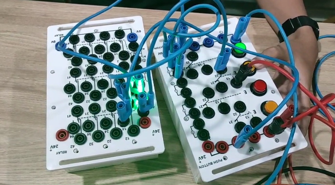
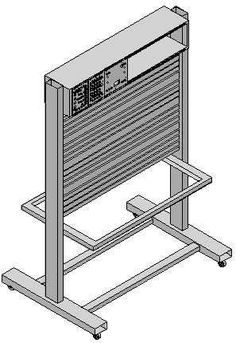
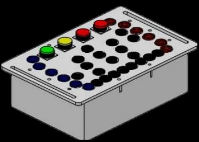
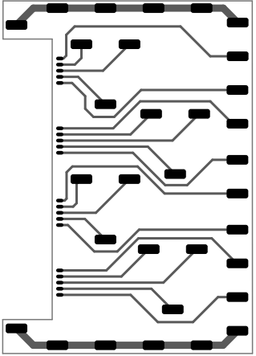
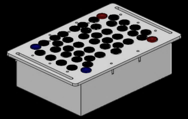
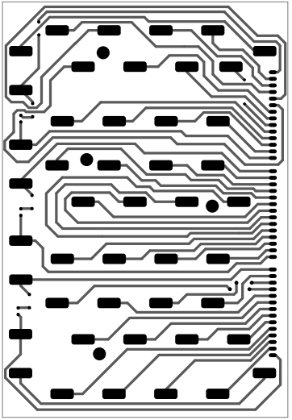

# Training Kit PLC model Workbench

A physical training workbench for learning push-button input and relay output logic before progressing to PLC integration.

> **Project type:** 2024–25 PBL; team project

## Overview

The project focused on developing the mechanical frame and input/output training panels. Push buttons are used as logical inputs, while relays represent controlled outputs.

The current development stage is a relay and push-button logic workbench created before advanced PLC integration.

## My Contribution

Served as PBL team lead and electrical lead according to the final report, and worked with the team to:

- Build the workbench frame from the beginning
- Create the relay box
- Create the push-button box
- Assemble and test the physical input/output system

## Main Components

- Mechanical workbench frame
- Push-button input panel
- Relay output panel
- Electrical wiring and connectors
- Panel and enclosure designs

## Result

The physical workbench and its input/output panels were successfully built and made functional.

## Engineering Documentation

### Workbench Frame CAD

Mechanical reference for the workbench frame.

### Push-Button Input Panel

CAD design of the push-button input box.

PCB and layout documentation for the push-button panel.

### Relay Output Panel

CAD design of the relay output box.

PCB and layout documentation for the relay panel.

## Next Development Stage

Integrate a PLC for more advanced control exercises and programming practice.
